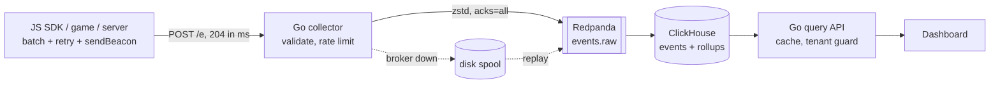

# Event Analytics (Pulse)

A self-hosted product analytics and event tracking platform for websites, mobile apps and games, built for write spikes and low cost per event.

> **ภาษาไทยสั้นๆ:** ระบบเก็บ event ของผู้ใช้ (เว็บ แอป เกม) แล้วแสดงเป็น dashboard ภาพรวม funnel retention และ event สด
> รันทั้งหมดได้ในเครื่องเดียวด้วย `docker compose up` แล้วค่อยขยายเป็นคลัสเตอร์ตาม [เอกสารสถาปัตยกรรม](docs/architecture.md)
> วิธีส่ง event จากเว็บหรือเกม ดูได้ที่ [docs/INTEGRATION.md](docs/INTEGRATION.md)



## What is in this repo

| Path | What |
| --- | --- |
| `cmd/collector`, `internal/collector` | Ingestion API: CORS, per-project rate limits, validation, clock-skew correction, enrichment (URL, UTM, referrer, device), returns 204 and produces to Kafka asynchronously |
| `internal/spool` | Disk fallback: when the broker is unreachable, events are written to local segments and replayed in order |
| `clickhouse/schema.sql` | Raw `events` table (MergeTree, JSON properties, per-plan TTL), Kafka ingest with an error table, rollups (`events_hourly`, `user_days`, `sessions`), read-only user with tenant row policies |
| `cmd/queryapi`, `internal/query` | Dashboard API: overview KPIs, trends, breakdowns, funnels (`windowFunnel`), weekly retention, live feed; result cache with request coalescing |
| `web/` | Dashboard (no build step) and `demo.html`, a test shop page that uses the SDK |
| `sdk/js/analytics.js` | Browser SDK (`window.pulse`): batching, `sendBeacon` on page hide, persistent retry queue with backoff, UUIDv7 ids, sessions, SPA pageviews, opt-out |
| `cmd/seed` | Generates 60 days of realistic demo data |
| `loadtest/collector.js` | k6 spike test |
| `docs/` | [Architecture design](docs/architecture.md), [integration guide](docs/INTEGRATION.md), [free single-VM deployment](docs/deploy-free-vm.md) |

## Quick start

Requirements: Docker with Compose v2.24+, and Go 1.24+ only if you want the demo data.

```bash
docker compose up -d --build
go run ./cmd/seed -brokers localhost:19092 -days 60 -users 4000   # optional demo data
```

| URL | |
| --- | --- |
| http://localhost:8081/?key=rk_demo | Dashboard (read key `rk_demo`) |
| http://localhost:8081/demo.html | Test shop page that sends events with the SDK |
| http://localhost:8080/e | Collector (write key `pk_demo`) |
| http://localhost:8080/metrics | Collector counters |

Send an event:

```bash
curl -X POST http://localhost:8080/e \
  -H 'Content-Type: application/json' -H 'X-Api-Key: pk_demo' \
  -d '[{"event":"level_complete","distinct_id":"player_1","properties":{"level_id":"w1_s3","stars":3}}]'
```

Add the SDK to a website:

```html
<script src="http://localhost:8081/sdk/analytics.js"></script>
<script>
  pulse.init({ key: "pk_demo", host: "http://localhost:8080" });
  pulse.capture("add_to_cart", { sku: "SNK-X", price: 2490 });
</script>
```

## Configuration

Projects (tenants) are configured with one environment variable, `PROJECTS`, on both services:

```
app_id|write_key|read_key|allowed_origins|events_per_sec|burst|retention_days
1|pk_demo|rk_demo|https://shop.example.com,https://www.shop.example.com|2000|6000|395
```

Separate projects with `;`. `allowed_origins` `*` accepts any origin. Rate limits are per collector instance.

| Service | Variable | Default |
| --- | --- | --- |
| collector | `LISTEN_ADDR`, `KAFKA_BROKERS`, `KAFKA_TOPIC`, `KAFKA_DLQ_TOPIC` | `:8080`, `localhost:19092`, `events.raw`, `events.dlq` |
| collector | `SPOOL_DIR`, `SPOOL_MAX_MB`, `PRODUCER_BUFFER_MB` | `./data/spool`, `2048`, `64` |
| queryapi | `LISTEN_ADDR`, `CLICKHOUSE_ADDR`, `CLICKHOUSE_USER`, `CLICKHOUSE_PASSWORD` | `:8081`, `localhost:9000`, `query_api`, dev password |
| queryapi | `TIMEZONE`, `COLLECTOR_PUBLIC_URL`, `WEB_DIR`, `SDK_DIR` | `Asia/Bangkok`, `http://localhost:8080`, `./web`, `./sdk/js` |

Change every password and key in `docker-compose.yml` and `clickhouse/schema.sql` before exposing the stack to the internet.

## Tested so far

Run on a 4 vCPU cloud container with everything (k6, collector, Redpanda, ClickHouse) on the same machine:

| Test | Result |
| --- | --- |
| k6 spike, 2,500 requests/s (1–5 events each) for 40 s | 341,943 events accepted, 341,943 rows in ClickHouse (0 lost), 0 errors, collector latency p95 2.7 ms |
| Broker outage: Redpanda stopped, 200 requests sent, Redpanda started | 200 × 204 returned, 200 events spooled to disk, all 200 replayed and queryable |
| Browser: SDK on `demo.html`, tab closed right after a click | Event delivered through `sendBeacon` |
| Unit tests | `go test ./...` (collector, spool, rate limiter, query API) |

These numbers are for one shared machine; dedicated hosts and the clustered layout in the design doc go much higher.

## Development

```bash
go test ./...
docker compose up -d redpanda topics clickhouse
go run ./cmd/collector &           # uses localhost:19092
go run ./cmd/queryapi              # uses localhost:9000, serves ./web
```

## SEO tab and automatic insights

- **SEO tab**: visits by channel (Search, AI, Social, Referral, Direct) per day, the search engines and AI assistants that send people, landing pages with search/AI visits and bounce rate, and Core Web Vitals (p75 LCP, INP, CLS, FCP, TTFB) by device and page.
- **Insights** (top of the overview): rule-based findings such as traffic drops or spikes, search or AI traffic rising or falling, pages people leave at once, slow pages on mobile, and game events that fell sharply. Thresholds ignore small numbers.
- API: `/api/seo`, `/api/vitals`, `/api/insights` (all take `days`).

## Roadmap (from the design doc)

- Enricher service: identity merging for `$identify`, PII scanner, GeoIP, schema checks
- GDPR/PDPA erasure API and export
- Redis-backed shared cache and rate limits for multi-instance deployments
- Clustered ClickHouse (replicas, S3 tiering) and 3-node Redpanda via Terraform/Helm
- Mobile and Unity SDKs
- Google Search Console import (keywords, impressions, average position) and AI-written weekly summaries
