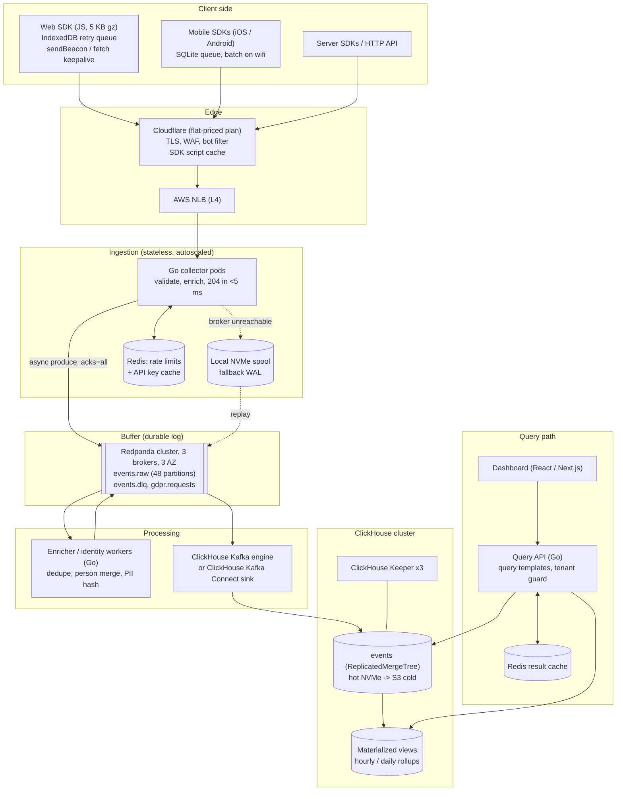
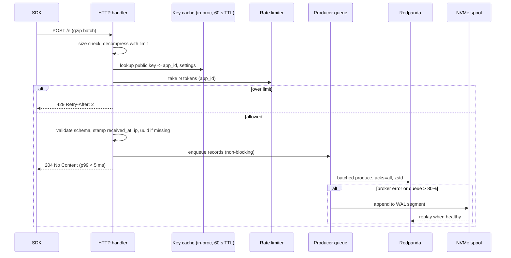
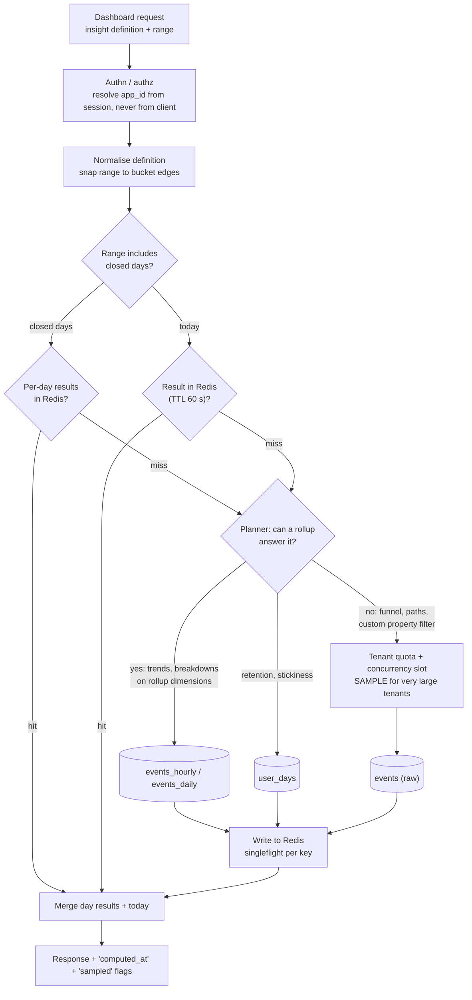
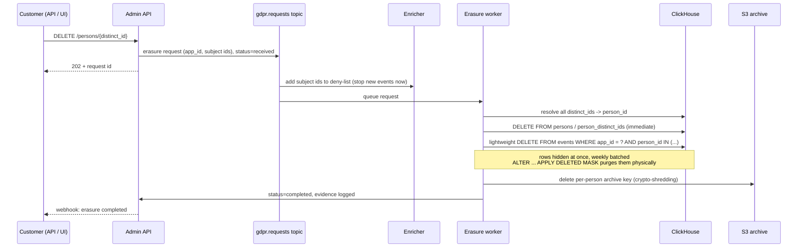
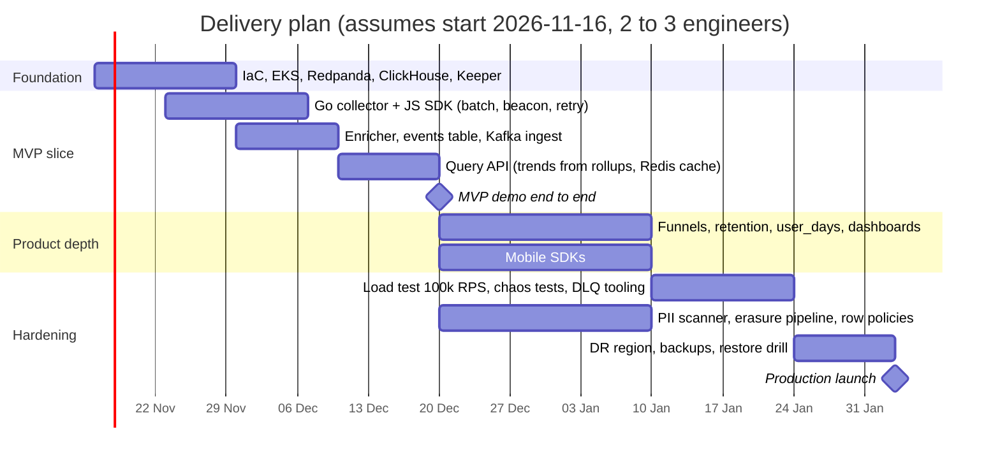

# Event Analytics Platform: System Architecture Design

Design document, November 2026.

## 0. Summary and capacity targets

The platform is a write-optimised, append-only pipeline: a stateless Go collector acknowledges every request in under 5 ms and hands events to Redpanda, which absorbs spikes for up to 72 hours while ClickHouse ingests at its own steady pace. Dashboards read pre-aggregated ClickHouse tables through a cached query API, so raw-event scans are the exception, not the rule. At the design point below the whole platform runs for roughly **USD 5,000 to 7,000 per month** on AWS, about **USD 0.75 per million events** stored and queryable.

**Design principles**

1. The client's website never waits on us: fire-and-forget beacons, async SDK, no blocking scripts.
2. Acknowledge fast, persist within milliseconds: the 204 goes out after an in-memory enqueue, and the event reaches Kafka or the collector's local disk spool within about 5 ms (ADR-003; \`?sync=1\` waits for the broker).
3. Every stage downstream of the collector pulls at its own rate. Nothing pushes into ClickHouse.
4. Store raw events once, compressed hard; answer most queries from rollups that are 100 to 1,000 times smaller.
5. Tenant (`app_id`) is the first key everywhere: partition key, sort key prefix, row policy, rate-limit bucket, cache key.

**Capacity assumptions** (the numbers every sizing in this document uses; adjust and the costs scale roughly linearly)

| Dimension | Baseline | Peak / burst | Notes |
| --- | --- | --- | --- |
| HTTP requests to collector | 2,000 RPS | 50,000 RPS sustained 30 min, 100,000 RPS 1-min burst | Flash sale or viral surge |
| Events per request | 1.5 avg | 3 avg | SDK batching |
| Events ingested | 3,000 /s, about 260 M/day | 150,000 /s | About 8 B rows/month |
| Raw event size | 600 B JSON |  | Properties map dominates |
| Kafka throughput | 1.8 MB/s raw | 90 MB/s raw, about 15 MB/s after zstd |  |
| ClickHouse stored size | about 45 B/event compressed |  | 12 GB/day, 360 GB/month hot |
| Dashboard queries | 20 QPS | 200 QPS | 85%+ served from cache or rollups |
| Freshness (event to dashboard) | under 10 s p95 | under 60 s during peak | Lag is allowed to grow; loss is not |

**Non-goals for v1:** session replay, feature flags, real-time (sub-second) alerting, and a self-serve SQL editor for customers. The architecture leaves room for each.

## 1. High-level architecture and data flow

Events travel through five decoupled stages, and each stage can fall behind the one before it without losing data: SDK queue, collector disk spool, Redpanda log, ClickHouse insert buffer, then MergeTree parts. The write path and the read path share only ClickHouse, and they use separate replicas so a dashboard storm cannot slow ingestion.



**Request lifecycle, step by step**

1. The SDK records the event, appends it to a local queue (IndexedDB or SQLite), and flushes every 5 s, every 20 events, or on page hide, whichever comes first.
2. The CDN terminates TLS, applies WAF and bot rules, and forwards to the NLB. The SDK script itself is served from CDN cache, so it never touches our origin.
3. The collector checks the API key against an in-process cache, applies the rate limit, validates the payload size and schema, stamps `server_received_at` and the client IP, and enqueues to the in-process Kafka producer. It returns **204 No Content** immediately.
4. The producer batches by partition (linger 5 ms, 256 KB batches, zstd) and writes to Redpanda with `acks=all`.
5. Enricher workers consume `events.raw`, do geo-IP and user-agent parsing, deduplicate by `event_uuid`, resolve identity (`distinct_id` to `person_id`), hash or drop PII per tenant settings, and write to `events.clean`.
6. ClickHouse ingests `events.clean` in large blocks (100k rows or 5 s) into the `events` table. Materialized views update rollup tables in the same insert.
7. The dashboard calls the Query API, which serves from Redis, then rollups, and only scans `events` for ad-hoc breakdowns, funnels and retention.

### Backpressure and decoupling during spikes

The rule is simple: **lag may grow, loss may not, and the client never feels it.** Each layer has a buffer and an explicit behaviour when that buffer fills.

| Layer | Buffer | Absorbs | When full |
| --- | --- | --- | --- |
| SDK | IndexedDB / SQLite queue, 1,000 events or 5 MB | Network drops, collector 429/5xx | Drop oldest low-priority events (`$pageleave`, heartbeats) first; never block the UI thread |
| Edge | CDN connection pooling | TLS handshake storms | Shields origin from connection churn |
| Collector | In-memory producer queue (64 MB per pod) | Broker latency up to a few seconds | Spill to local NVMe spool (20 GB per pod, about 30 min at peak per pod) |
| Collector admission | Per-tenant token bucket + global concurrency limit | One tenant's spike | Return **429 with Retry-After**; SDK backs off with jitter and keeps the events |
| Redpanda | Disk log, 72 h retention, tiered to S3 | ClickHouse slow, down, or in maintenance | Alert at 6 h lag; add consumers or ClickHouse capacity |
| ClickHouse ingest | Async insert buffer / sink batch | Bursty arrivals | Consumer pauses (Kafka offsets simply stop advancing) |
| ClickHouse merges | Parts count per partition | Too many small inserts | `parts_to_delay_insert` slows the consumer, which pushes lag back into Redpanda |

Three properties make this work. First, the collector is the only synchronous component, and it does no I/O on the request path beyond an in-memory enqueue. Second, ClickHouse is never written to by the collector, so its throughput ceiling is irrelevant to the client. Third, consumers pull, so a slow sink naturally becomes consumer lag in Redpanda instead of errors at the edge. A 30-minute flash sale at 150k events/s produces about 270 M events (about 25 GB compressed in Redpanda), which a ClickHouse cluster that sustains 300k rows/s drains in roughly 15 minutes after the spike ends.

## 2. Ingestion layer and API gateway

The collector is a single Go binary built on `net/http` (or `fasthttp` if profiling shows allocation pressure) with `franz-go` as the Kafka client. One 2 vCPU / 2 GB pod handles about 15,000 to 20,000 RPS at p99 under 5 ms, so peak traffic of 100k RPS needs roughly 8 to 10 pods with headroom; baseline needs 2 (kept at 3 for AZ spread).

### Why Go over Rust (and over Node or JVM)

| Option | Throughput per core | Memory per pod | Team velocity | Kafka client maturity | Verdict |
| --- | --- | --- | --- | --- | --- |
| **Go** | High (goroutines, \~4 KB stacks) | 50 to 150 MB | High, easy hiring | `franz-go`, very mature | **Chosen** |
| Rust (axum + rdkafka) | Highest, no GC pauses | 20 to 60 MB | Lower, slower iteration | `rdkafka` (librdkafka binding) | Good later for the hottest path only |
| Node.js | Medium, single-threaded event loop | 150 to 300 MB | High | `kafkajs` (less maintained) | Rejected: GC and CPU per request |
| JVM (Netty / Vert.x) | High | 500 MB+ | Medium | Native client, best | Rejected: memory cost per pod |

The collector does almost no CPU work (parse, validate, enqueue), so the difference between Go and Rust is about 20 to 30% in pods, roughly USD 100 to 200 a month at this scale. Go's development speed is worth more than that. See ADR-002.

### Endpoints

| Method and path | Purpose | Body |
| --- | --- | --- |
| `POST /e` | Batch of events (primary) | JSON array or NDJSON, gzip allowed, max 512 KB compressed / 2 MB decompressed, max 100 events |
| `POST /e?beacon=1` | `sendBeacon` variant | `text/plain` (a CORS-safelisted type, so no preflight) |
| `GET /p.gif` | Pixel fallback for no-JS and email opens | Query string, max 4 KB |
| `POST /decide` | Remote config for the SDK (sampling rate, flush interval, kill switch) | Cached at CDN for 60 s per key |
| `GET /healthz`, `/readyz` | Liveness, readiness (readiness fails if the spool is above 80% or the broker is unreachable for over 30 s) |  |

### Request path inside the collector



**Durability trade-off.** Returning 204 before the broker acknowledges means a pod crash can lose the few milliseconds of events sitting in its in-memory queue (at most about 5 ms times that pod's throughput, a few hundred events). For analytics this is the right trade (ADR-003). For tenants who need stronger guarantees, offer `?sync=1`, which waits for the broker ack (p99 about 15 to 30 ms) and is meant for server-side SDKs only. Running the in-memory queue as a memory-mapped WAL on NVMe closes most of this gap at a small latency cost.

### Hot path code shape (abridged)

```go
func (s *Server) handleEvents(w http.ResponseWriter, r *http.Request) {
    body := http.MaxBytesReader(w, r.Body, 512<<10)
    key := r.Header.Get("X-Api-Key") // or ?k= for beacon
    app, ok := s.keys.Get(key)          // in-process LRU, refreshed from Redis
    if !ok { w.WriteHeader(http.StatusUnauthorized); return }

    events, err := decodeBatch(body, r.Header.Get("Content-Encoding"), 2<<20)
    if err != nil || len(events) == 0 || len(events) > 100 {
        w.WriteHeader(http.StatusBadRequest); return
    }
    if !s.limiter.AllowN(app.ID, len(events)) {
        w.Header().Set("Retry-After", "2")
        w.WriteHeader(http.StatusTooManyRequests); return
    }
    now := time.Now().UTC()
    ip := clientIP(r) // from X-Forwarded-For, trusted proxy list only
    for i := range events {
        events[i].Stamp(app.ID, now, ip)       // fill uuid, received_at, sent_at skew
        s.producer.Produce(events[i].Record()) // non-blocking; spills to WAL when full
    }
    w.WriteHeader(http.StatusNoContent)
}
```

Key implementation details: pool decode buffers with `sync.Pool`; use a streaming JSON decoder (`goccy/go-json` or `sonic`) instead of reflection-heavy `encoding/json`; set `GOMEMLIMIT` to 80% of the pod limit so GC tightens before the OOM killer acts; and keep the handler free of any network call except on key-cache miss.

### CORS

- `POST /e` with `Content-Type: text/plain` and no custom headers is a CORS simple request, so browsers skip the preflight. The SDK sends the key in the body or query string for this reason, which halves request count.
- When preflight does happen (custom headers), answer `OPTIONS` at the CDN edge with `Access-Control-Max-Age: 86400`, so origin never sees it.
- `Access-Control-Allow-Origin` echoes the request `Origin` only if it matches the tenant's allowed-domains list (cached with the key). Unknown origins still get a 204 but the event is tagged `origin_mismatch` and dropped in the enricher, so attackers learn nothing from responses.
- No cookies, so `Access-Control-Allow-Credentials` stays off. Identity lives in first-party storage on the client.

### Rate limiting (three tiers)

1. **Edge (CDN / WAF):** per-IP limits (for example 300 requests per minute) and bot signatures. Cheapest place to drop junk.
2. **Per-tenant token bucket in the collector:** bucket size and refill come from the tenant's plan. Each pod keeps a local bucket sized at `plan_rate / pod_count` and reconciles with Redis every second (approximate global limiting without a Redis round-trip per request). Burst allowance is 3x plan rate for 60 s so a legitimate flash sale is absorbed.
3. **Global concurrency guard:** if in-flight requests per pod exceed a threshold, shed with 429 before parsing. This protects the pod itself.

Every 429 includes `Retry-After`; the SDK keeps the events and retries, so a rate limit delays data rather than losing it.

### Validation

- Hard limits: 100 events per batch, 32 KB per event, 200 properties per event, 255-character event names, property keys matching `^[$a-zA-Z0-9_.\-]{1,128}$`.
- Timestamps: accept a client `timestamp` and `sent_at`; compute clock skew as `received_at - sent_at` and correct the event time by it. Reject events more than 7 days old or 1 hour in the future (route them to the DLQ with a reason).
- Schema is permissive at the edge (unknown properties pass through) and strict in the enricher, which can apply per-tenant schemas and type coercion. Keeping the edge permissive keeps it fast and avoids rejecting data we might want later.

### Client SDK strategy for unreliable networks

- **Batch:** flush on 20 events, 5 s, or `visibilitychange` to `hidden`, whichever first. Gzip with `CompressionStream` when the batch is over 1 KB (typically 5 to 10x smaller).
- **Unload delivery:** on `visibilitychange: hidden` and `pagehide`, use `navigator.sendBeacon()` (64 KB limit, the browser delivers it even after the tab closes). Fall back to `fetch(url, {keepalive: true})`. Never use `beforeunload` or synchronous XHR.
- **Retry queue:** persist unsent batches to IndexedDB (localStorage as fallback). Retry with exponential backoff plus full jitter (1 s, 2 s, 4 s, up to 5 min), honour `Retry-After`, and retry on `online` events. Cap the queue at 1,000 events, evicting the lowest-priority first.
- **Idempotency:** the SDK generates `event_uuid` (UUIDv7, time-ordered) at capture time, so retries are deduplicated downstream (Section 3 and 4).
- **Zero impact on host page:** load the script `async` from the CDN; do all work in `requestIdleCallback`; no synchronous storage access on the main thread during interaction; never throw into the host page (wrap everything in try/catch).
- **Server-controlled sampling:** `/decide` returns a sampling rate and flush interval per tenant, so during an extreme incident we can ask SDKs to batch harder (for example every 30 s) or sample autocapture events at 10%, without a client deploy.
- **Mobile:** SQLite-backed queue, flush on app background, batch more aggressively on cellular, use `BGTaskScheduler` / WorkManager for deferred delivery.
- **Ad-blocker resilience:** let tenants proxy the collector through their own domain (CNAME or a reverse-proxy path like `/ingest`), which also makes requests first-party.

## 3. Stream buffer and message queue

**Recommendation: Redpanda** (Kafka API compatible) on 3 storage-optimised instances across 3 AZs, with tiered storage to S3. It gives Kafka semantics and ecosystem (ClickHouse Kafka engine, Kafka Connect, `franz-go`) without ZooKeeper or JVM tuning, and typically needs one-third to one-half the hardware of Apache Kafka for the same throughput. If the team prefers fully managed, AWS MSK Serverless or Confluent Cloud are drop-in replacements because the API is identical (ADR-004).

### Options compared

| Option | Peak throughput fit | Replay and retention | Ordering | Ops burden | Cost at our peak (about 90 MB/s raw) | Verdict |
| --- | --- | --- | --- | --- | --- | --- |
| **Redpanda (self-managed)** | Excellent, C++ thread-per-core | Days to weeks, S3 tiering | Per partition | Low to medium | About USD 1,000 to 1,500/mo (3 x i4i.xlarge) | **Chosen** |
| Apache Kafka (self-managed, KRaft) | Excellent | Same, tiered storage in 3.6+ | Per partition | Medium to high (JVM, tuning) | About USD 1,500 to 2,500/mo | Good alternative |
| AWS MSK / MSK Serverless | Excellent | Same | Per partition | Low | About USD 2,000 to 4,000/mo | Choose if no Kafka ops skills |
| Confluent Cloud | Excellent | Same | Per partition | Lowest | About USD 3,000 to 6,000/mo | Fastest start, highest cost |
| AWS Kinesis Data Streams | Good, 1 MB/s per shard write cap, so about 100+ shards at peak | 24 h default, up to 365 d at extra cost | Per shard | Low | About USD 2,500+/mo provisioned at peak; on-demand cheaper at baseline but spiky | Rejected: shard math, weaker ClickHouse integration |
| AWS SQS | Unlimited | No replay, 14 d max, delete on consume | None (FIFO capped) | Lowest | Per-request pricing, about USD 0.40 per million, adds up at billions | Rejected: no replay, no fan-out |

The deciding factors are **replay** (re-ingest after a bad deploy or a ClickHouse rebuild), **fan-out** (ClickHouse, enrichment, future real-time alerting and S3 archive all read the same log independently) and **cost per GB at sustained throughput**. Only the Kafka family does all three well.

### Topics

| Topic | Partitions | Retention | Key | Producers / consumers |
| --- | --- | --- | --- | --- |
| `events.raw` | 48 | 72 h local, 14 d in S3 tier | `app_id:distinct_id` | Collector / enricher |
| `events.clean` | 48 | 72 h local, 7 d in S3 tier | `app_id:distinct_id` | Enricher / ClickHouse, S3 archiver |
| `events.dlq` | 6 | 14 d | `app_id` | Collector and enricher / DLQ inspector, replay tool |
| `persons.updates` | 12 | Compacted | `app_id:person_id` | Enricher / ClickHouse `persons` table |
| `gdpr.requests` | 3 | Compacted, infinite | `app_id:subject_id` | Admin API / erasure worker |

48 partitions gives about 2 MB/s compressed per partition at peak (well within a partition's comfortable limit) and lets up to 48 consumer instances run in parallel. Partition count can only grow, and growing it reshuffles key ordering, so we start with headroom.

### Partition key strategy

- **Key = `app_id` + `distinct_id`** (hashed). This keeps one user's events in order on one partition, which the enricher needs for identity merging and deduplication, and spreads load evenly because users vastly outnumber partitions.
- **Why not `app_id` alone:** one large tenant in a flash sale would pin a single partition and create a hot spot. Why not random: loses per-user ordering and makes dedupe windows per partition useless.
- **Hot-key guard:** a bot or a misconfigured SDK sending millions of events under one `distinct_id` would still create a hot partition. The collector tracks top keys per second (count-min sketch) and, above a threshold, salts the key (`distinct_id#n`) and tags the events so the enricher can flag them.

### Producer batching and compression

| Setting (franz-go / librdkafka name) | Value | Why |
| --- | --- | --- |
| `linger` (`linger.ms`) | 5 ms | Fill batches without hurting latency (client already has its 204) |
| `max batch bytes` (`batch.size`) | 256 KB to 1 MB | Bigger batches compress better and cut broker request rate |
| `compression` | **zstd level 3** | About 5 to 8x on JSON events vs about 2 to 3x for Snappy and LZ4; CPU cost is modest at level 3 |
| `acks` | `all` (min.insync.replicas = 2) | No loss on a single broker failure |
| `idempotent producer` | on | No duplicates from producer retries |
| `max buffered records` | sized to 64 MB per pod | Bounded memory; overflow spills to the disk spool |
| Retries | Unlimited within a 2-minute delivery timeout, then spool to disk | Never drop on transient broker issues |

**Compression choice.** Snappy and LZ4 are faster but compress JSON poorly; zstd at level 3 costs roughly 1.5x the CPU of LZ4 and saves 2 to 3x on network, broker disk, and inter-AZ transfer. Inter-AZ traffic is billed at USD 0.01/GB each way on AWS and replication triples it, so at billions of events per month zstd pays for itself many times over. Set the topic's `compression.type=producer` so brokers store batches as sent without recompressing.

**Encoding.** v1 sends JSON for simplicity and flexibility of the properties map. Once schemas stabilise, moving `events.clean` to Protobuf (with a schema registry) cuts size by another 30 to 50% and speeds up ClickHouse parsing; `events.raw` stays JSON because it mirrors what clients send.

### Exactly-once in practice

True end-to-end exactly-once is expensive and unnecessary. We get **effectively once** by combining: an SDK-generated `event_uuid`, an idempotent producer, a dedupe window in the enricher (an in-memory set of recent UUIDs per partition, 10 minutes), and `ReplacingMergeTree`-style dedupe or insert deduplication tokens in ClickHouse for replays. Residual duplicates are well below 0.01%.

## 4. Storage layer: ClickHouse

ClickHouse stores raw events in one `ReplicatedMergeTree` table sorted by `(app_id, date, event, user hash, timestamp)`, so a typical dashboard query reads only one tenant's granules for the requested days, often under 0.1% of the table. With LowCardinality columns, per-column codecs and zstd, events compress to about 45 bytes each (roughly 12 to 15x versus raw JSON). Data lives 30 days on fast disk, then moves to S3, and expires per tenant plan.

### Cluster topology

- **Start:** 1 shard x 2 replicas in 2 AZs (r7g.4xlarge: 16 vCPU, 128 GB RAM, 1.5 TB gp3 each) plus 3 ClickHouse Keeper nodes (t4g.medium). One shard comfortably ingests over 500k rows/s and holds the 30-day hot set (about 400 GB) with room to spare.
- **Read/write split:** the ingest consumer inserts on replica A; the Query API prefers replica B (`load_balancing = 'first_or_random'` with B listed first). Add a third replica for reads before adding shards.
- **Scale out** to 2+ shards when hot data per shard passes about 3 TB or merges fall behind. Writes then go through a `Distributed` table with sharding key `sipHash64(app_id, distinct_id)`, so all events of one user land on one shard. Funnels and retention then run per shard in parallel and merge small results (`distributed_group_by_no_merge` where safe).

### Raw events table

```sql
CREATE TABLE analytics.events ON CLUSTER '{cluster}'
(
    app_id            UInt32,
    timestamp         DateTime64(3, 'UTC')        CODEC(Delta, ZSTD(1)),
    event             LowCardinality(String),
    event_uuid        UUID,
    distinct_id       String                      CODEC(ZSTD(3)),
    person_id         UUID,
    session_id        String                      CODEC(ZSTD(3)),

    -- Promoted ("materialized") properties: the ones dashboards filter on
    url               String                      CODEC(ZSTD(3)),
    pathname          String                      CODEC(ZSTD(3)),
    referrer_domain   LowCardinality(String),
    utm_source        LowCardinality(String),
    utm_medium        LowCardinality(String),
    utm_campaign      String                      CODEC(ZSTD(3)),
    country_code      LowCardinality(FixedString(2)),
    region            LowCardinality(String),
    city              LowCardinality(String),
    device_type       LowCardinality(String),
    os                LowCardinality(String),
    browser           LowCardinality(String),
    app_version       LowCardinality(String),
    lib               LowCardinality(String),      -- sdk name and version

    -- Everything else, typed per path by the JSON type (ClickHouse 25.3+)
    properties        JSON(max_dynamic_paths = 512) CODEC(ZSTD(3)),

    -- Housekeeping
    retention_days    UInt16 DEFAULT 395,          -- from tenant plan, set by enricher
    received_at       DateTime64(3, 'UTC')        CODEC(Delta, ZSTD(1)),
    inserted_at       DateTime DEFAULT now()      CODEC(Delta, ZSTD(1)),

    INDEX idx_uuid        event_uuid  TYPE bloom_filter(0.001) GRANULARITY 4,
    INDEX idx_distinct_id distinct_id TYPE bloom_filter(0.01)  GRANULARITY 4,
    INDEX idx_person_id   person_id   TYPE bloom_filter(0.01)  GRANULARITY 4,
    INDEX idx_pathname    pathname    TYPE tokenbf_v1(10240, 3, 0) GRANULARITY 4
)
ENGINE = ReplicatedMergeTree('/clickhouse/tables/{shard}/analytics/events', '{replica}')
PARTITION BY (retention_days, toYYYYMM(timestamp))
ORDER BY (app_id, toDate(timestamp), event, cityHash64(distinct_id), timestamp)
SAMPLE BY cityHash64(distinct_id)
TTL toDateTime(timestamp) + INTERVAL 30 DAY TO VOLUME 'cold',
    toDateTime(timestamp) + toIntervalDay(retention_days) DELETE
SETTINGS storage_policy = 'hot_cold',
         index_granularity = 8192,
         ttl_only_drop_parts = 1,
         min_bytes_for_wide_part = 10485760;
```

### Why each choice

| Decision | Choice | Reasoning | Trade-off accepted |
| --- | --- | --- | --- |
| Engine | `ReplicatedMergeTree` | Replication via Keeper, append-only fits events | Duplicates possible on replay; handled with insert dedup tokens and query-time `uniq(event_uuid)` where it matters |
| Sort key prefix | `app_id` | Every query filters by tenant; tenants become contiguous ranges, so other tenants' data is never read | Very large tenants can still make a range large; handled by date as second key |
| Second key | `toDate(timestamp)` | Nearly every query has a date range; funnels span many events, so date before event serves them better | Single-event lookups over long ranges read a little more than `event`-second would |
| Third key | `event` | Narrows granules for event-specific trends |  |
| Fourth key | `cityHash64(distinct_id)` | Groups a user's events together for funnels and retention, and enables `SAMPLE` |  |
| Partition | `(retention_days, month)` | Monthly parts are the ClickHouse sweet spot (about 8 B rows per month here); the retention tier in the key means expired data drops as whole parts, which is near-free | Roughly 4 tiers x 25 months = 100 partitions, well under the danger zone of thousands |
| Not partitioned by `app_id` |  | Thousands of tenants would create thousands of tiny parts and kill merges | Tenant deletes use lightweight delete instead of `DROP PARTITION` |
| Properties | JSON type plus promoted columns | Top 20 to 30 properties as real columns are fastest; the JSON type stores every other path as its own sub-column, so `properties.plan` reads only that path | Paths beyond 512 per part fall into a shared, slower store. Fallback for older versions: `String` with `JSONExtract` plus promoting hot keys via `ALTER TABLE ... ADD COLUMN ... MATERIALIZED` |
| Sampling | `SAMPLE BY cityHash64(distinct_id)` | Lets huge tenants get approximate answers in a tenth of the time (`SAMPLE 0.1`), sampled by user so funnels stay consistent | Answers flagged as estimated in the UI |

### Ingest from Redpanda

```sql
CREATE TABLE analytics.events_queue ON CLUSTER '{cluster}'
(
    app_id UInt32, timestamp DateTime64(3, 'UTC'), event String, event_uuid UUID,
    distinct_id String, person_id UUID, session_id String,
    url String, pathname String, referrer_domain String,
    utm_source String, utm_medium String, utm_campaign String,
    country_code String, region String, city String,
    device_type String, os String, browser String, app_version String, lib String,
    properties String, retention_days UInt16, received_at DateTime64(3, 'UTC')
)
ENGINE = Kafka
SETTINGS kafka_broker_list       = 'redpanda-0:9092,redpanda-1:9092,redpanda-2:9092',
         kafka_topic_list        = 'events.clean',
         kafka_group_name        = 'clickhouse-events',
         kafka_format            = 'JSONEachRow',
         kafka_num_consumers     = 8,
         kafka_max_block_size    = 1048576,
         kafka_flush_interval_ms = 5000,
         kafka_handle_error_mode = 'stream';

CREATE MATERIALIZED VIEW analytics.events_queue_mv TO analytics.events AS
SELECT * EXCEPT (properties), properties::JSON AS properties
FROM analytics.events_queue
WHERE length(_error) = 0;

CREATE MATERIALIZED VIEW analytics.events_queue_errors_mv TO analytics.ingest_errors AS
SELECT now() AS ts, _topic AS topic, _partition AS partition, _offset AS offset,
       _raw_message AS raw, _error AS error
FROM analytics.events_queue
WHERE length(_error) > 0;
```

Large blocks (up to 1 M rows, flushed at least every 5 s) keep the number of new parts low, which is the single most important ClickHouse ingest rule. Malformed rows go to `ingest_errors` instead of blocking the partition. If exactly-once into ClickHouse becomes a requirement, swap the Kafka engine for the ClickHouse Kafka Connect sink, which tracks offsets in Keeper.

### Storage tiering

```xml
<clickhouse>
  <storage_configuration>
    <disks>
      <hot><path>/var/lib/clickhouse/hot/</path></hot>               <!-- gp3 EBS -->
      <s3>
        <type>s3</type>
        <endpoint>https://analytics-ch-cold.s3.ap-southeast-1.amazonaws.com/{replica}/</endpoint>
        <use_environment_credentials>true</use_environment_credentials>
      </s3>
      <s3_cached>
        <type>cache</type>
        <disk>s3</disk>
        <path>/var/lib/clickhouse/s3_cache/</path>
        <max_size>150Gi</max_size>
      </s3_cached>
    </disks>
    <policies>
      <hot_cold>
        <volumes>
          <hot><disk>hot</disk></hot>
          <cold><disk>s3_cached</disk></cold>
        </volumes>
        <move_factor>0.1</move_factor>
      </hot_cold>
    </policies>
  </storage_configuration>
</clickhouse>
```

| Tier | Holds | Medium | Approx. cost per GB-month | Query latency |
| --- | --- | --- | --- | --- |
| Hot | Last 30 days raw, all rollups | gp3 EBS | USD 0.08 | 10s to 100s of ms |
| Cold | Day 31 to retention end, raw | S3 Standard behind a 150 GB local cache | USD 0.023 | 1 to 5 s for uncached scans |
| Archive | Raw `events.clean` as Parquet, forever or per contract | S3 Glacier Instant Retrieval, written by an archiver consumer | USD 0.004 | Minutes (re-ingest or query with `s3()` table function) |

With monthly partitions, a part moves to S3 once its newest row is 30 days old, so the hot tier holds 30 to 60 days in practice. That is fine; switch to `toMonday(timestamp)` partitions if hot capacity gets tight. Zero-copy replication on S3 stays off (it is not recommended for production), so each replica keeps its own cold copy; that doubles a small S3 bill but avoids a class of hard bugs.

### Compression codecs

| Column type | Codec | Typical ratio |
| --- | --- | --- |
| Repeating strings (event name, browser, country, UTM) | `LowCardinality(String)` (dictionary) | 20 to 50x |
| Timestamps | `Delta` + `ZSTD(1)` | 10 to 30x (sorted within a granule) |
| Free-text strings (url, distinct\_id) | `ZSTD(3)` | 4 to 8x |
| JSON properties | `ZSTD(3)` per path sub-column | 8 to 15x |
| UUIDs | Default LZ4 (random data, compression does not help) | about 1x |
| Rollup counters | `T64` + `ZSTD(1)` or `Gorilla` for floats | 5 to 20x |

ZSTD(3) costs a little more CPU than the default LZ4 on insert and is roughly as fast to decompress for these sizes, and it saves 30 to 50% of disk. Do not go above ZSTD(3) for hot data; for cold parts, set `ZSTD(6)` through a `TTL ... RECOMPRESS CODEC(ZSTD(6))` rule to squeeze another 10 to 15% from S3.

### Retention and downsampling

Raw rows are the expensive layer; rollups are tiny and cheap to keep. Retention is therefore set per layer:

| Layer | Granularity | Retention | Size vs raw |
| --- | --- | --- | --- |
| `events` (raw) | Per event | Per plan: 30, 90, 395 or 760 days | 1x |
| `events_hourly` rollup | Hour x app x event x top dimensions | 25 months | about 1/200 |
| `events_daily` rollup | Day x app x event x dimensions | Forever | about 1/2,000 |
| `sessions` | Per session | Same as raw | about 1/10 |
| `persons`, `person_distinct_ids` | Per user | Until deleted | small |

Old-period trend charts come from rollups even after raw rows expire, which is how a free plan with 30-day raw retention can still show a 12-month trend line. The rollup DDL is in Section 5.

### Other cost levers

- **Promote, don't scan:** watch `system.query_log` weekly for JSON paths used in filters and promote the top ones to real columns (`ALTER TABLE ... ADD COLUMN plan LowCardinality(String) MATERIALIZED properties.plan::String`).
- **Drop what nobody queries:** autocapture events that no saved insight references after 30 days can be moved to a lower retention tier by the enricher.
- **Graviton (arm64) instances:** about 20% cheaper than x86 for the same ClickHouse throughput.
- **Savings plans:** commit 1 year on the steady baseline (ClickHouse, Redpanda, Keeper), keep only collectors on spot or on-demand autoscaling.
- **Insert hygiene:** never more than about 1 insert per second per table per replica; this keeps merges cheap and CPU free for queries.

## 5. Query, caching and aggregation layer

The Query API answers most dashboard requests without touching raw events: Redis serves repeats, closed days come from per-day cached results, and materialized-view rollups answer trends and breakdowns. Only funnels, retention, paths and ad-hoc filters on uncommon properties scan `events`, and those run under per-tenant quotas. Target: p95 under 500 ms for cached and rollup queries, under 3 s for raw funnel and retention queries on 30 days of a large tenant.

### Query routing



### Query API design

- **Go service, stateless, 3+ pods.** It exposes typed endpoints, not SQL: `POST /api/insights/trend`, `/funnel`, `/retention`, `/paths`, `/breakdown`, plus `/api/dashboards/{id}` which fans out to tiles in parallel.
- **Query templates with bound parameters.** Each insight type compiles to SQL from a whitelist of events, properties and operators. Values go in as ClickHouse query parameters (`{app_id:UInt32}`), never string concatenation, so there is no SQL injection surface.
- **The server injects `app_id`.** It comes from the authenticated session and is added to every query, and ClickHouse row policies enforce it again (Section 6).
- **Guardrails per query:** `readonly = 1`, `max_execution_time = 30`, `max_memory_usage = 8 GB`, `max_threads = 8`, `max_rows_to_read` by plan, and `max_concurrent_queries_for_user`. These live in ClickHouse settings profiles and quotas per plan tier, so the database enforces them even if the API has a bug.
- **Heavy queries go async:** anything estimated (by `EXPLAIN ESTIMATE`) above a row threshold returns a job id; the UI polls or gets a websocket push. This keeps HTTP workers free.
- **Separate replicas for reads:** dashboards hit read replicas only, so a query storm never starves ingestion.

### Pre-aggregation with materialized views

Materialized views run on every insert into `events`, so rollups are always current with no batch jobs.

```sql
-- Hourly rollup for trends and breakdowns
CREATE TABLE analytics.events_hourly ON CLUSTER '{cluster}'
(
    app_id          UInt32,
    hour            DateTime,
    event           LowCardinality(String),
    pathname        String,                       -- normalised by enricher (ids stripped)
    referrer_domain LowCardinality(String),
    utm_source      LowCardinality(String),
    country_code    LowCardinality(FixedString(2)),
    device_type     LowCardinality(String),
    browser         LowCardinality(String),
    events          SimpleAggregateFunction(sum, UInt64),
    users           AggregateFunction(uniqCombined64, String),
    sessions        AggregateFunction(uniqCombined64, String)
)
ENGINE = ReplicatedAggregatingMergeTree('/clickhouse/tables/{shard}/analytics/events_hourly', '{replica}')
PARTITION BY toYYYYMM(hour)
ORDER BY (app_id, hour, event, pathname, referrer_domain, utm_source, country_code, device_type, browser)
TTL hour + INTERVAL 25 MONTH DELETE;

CREATE MATERIALIZED VIEW analytics.events_hourly_mv ON CLUSTER '{cluster}'
TO analytics.events_hourly AS
SELECT app_id, toStartOfHour(timestamp) AS hour, event, pathname, referrer_domain,
       utm_source, country_code, device_type, browser,
       count()                             AS events,
       uniqCombined64State(distinct_id)     AS users,
       uniqCombined64State(session_id)      AS sessions
FROM analytics.events
GROUP BY app_id, hour, event, pathname, referrer_domain, utm_source,
         country_code, device_type, browser;

-- One row per user per active day: retention, stickiness, DAU/WAU/MAU
CREATE TABLE analytics.user_days ON CLUSTER '{cluster}'
(
    app_id    UInt32,
    day       Date,
    person_id UUID,
    events    SimpleAggregateFunction(sum, UInt64),
    first_seen SimpleAggregateFunction(min, DateTime64(3, 'UTC'))
)
ENGINE = ReplicatedAggregatingMergeTree('/clickhouse/tables/{shard}/analytics/user_days', '{replica}')
PARTITION BY toYYYYMM(day)
ORDER BY (app_id, day, person_id);

CREATE MATERIALIZED VIEW analytics.user_days_mv ON CLUSTER '{cluster}'
TO analytics.user_days AS
SELECT app_id, toDate(timestamp) AS day, person_id,
       count() AS events, min(timestamp) AS first_seen
FROM analytics.events
GROUP BY app_id, day, person_id;
```

`events_daily` is the same shape as `events_hourly` at day grain, fed by a materialized view on `events_hourly` (a cascade, so it reads the small table). Keep high-cardinality dimensions out of rollups: `pathname` is normalised (`/product/123` becomes `/product/:id`) and capped per tenant to the top 10,000 values, with the rest grouped as `(other)`.

**Example: unique users per day for the last 30 days from the rollup** (reads about 1/200 of the raw data):

```sql
SELECT toDate(hour) AS day,
       sum(events) AS events,
       uniqCombined64Merge(users) AS users
FROM analytics.events_hourly
WHERE app_id = {app_id:UInt32}
  AND hour >= {from:DateTime} AND hour < {to:DateTime}
  AND event = '$pageview'
GROUP BY day ORDER BY day;
```

**Example: four-step funnel** with ClickHouse's built-in `windowFunnel` (one pass, no self-joins):

```sql
SELECT level, count() AS users
FROM (
    SELECT person_id,
           windowFunnel(86400)(toDateTime(timestamp),
               event = '$pageview' AND pathname = '/product/:id',
               event = 'add_to_cart',
               event = 'checkout_started',
               event = 'purchase') AS level
    FROM analytics.events
    WHERE app_id = {app_id:UInt32}
      AND toDate(timestamp) BETWEEN {from:Date} AND {to:Date}
      AND event IN ('$pageview', 'add_to_cart', 'checkout_started', 'purchase')
    GROUP BY person_id
)
GROUP BY level
ORDER BY level;
-- users who reached step n = sum of users at level >= n (computed in the API)
```

**Example: weekly retention from `user_days`** (no raw scan):

```sql
WITH cohort AS (
    SELECT person_id, toMonday(min(first_seen)) AS cohort_week
    FROM analytics.user_days
    WHERE app_id = {app_id:UInt32}
    GROUP BY person_id
    HAVING cohort_week BETWEEN {from:Date} AND {to:Date}
)
SELECT c.cohort_week,
       dateDiff('week', c.cohort_week, toMonday(u.day)) AS week_n,
       uniqExact(u.person_id) AS users
FROM analytics.user_days AS u
INNER JOIN cohort AS c USING (person_id)
WHERE u.app_id = {app_id:UInt32}
  AND u.day >= {from:Date} AND u.day < {to:Date} + INTERVAL 12 WEEK
GROUP BY c.cohort_week, week_n
ORDER BY c.cohort_week, week_n;
```

For retention defined by a specific start event (for example `signed_up`), the cohort subquery reads `events` filtered to that one event, which the sort key makes cheap.

### Caching strategy (Redis)

| Technique | How | Effect |
| --- | --- | --- |
| Result cache key | `sha256(app_id, insight_type, normalised definition, bucketed range, data_version)` | Identical tiles across users and dashboards share one entry |
| Recency-based TTL | Range ends before today: 24 h (data is effectively immutable). Includes today: 60 s. Real-time tile: 15 s | Old data is computed once; fresh data stays fresh |
| Day-split incremental caching | Cache each closed day's result separately; on request, compute only missing days and today, then merge | A 90-day chart after the first view costs about 1 day of compute |
| Request coalescing | `singleflight` per cache key inside each API pod, plus a short Redis lock across pods | 500 people opening the same dashboard in a sale trigger 1 query, not 500 |
| Stale-while-revalidate | Serve the expired entry immediately, refresh in the background | No latency cliffs at TTL expiry |
| Pre-warming | A scheduler refreshes saved dashboards of tenants active in the last 7 days, every 5 to 15 minutes depending on plan | Opening a dashboard is a cache hit |
| Late-data invalidation | The enricher bumps `data_version:{app_id}:{day}` when events arrive for a closed day (offline mobile flushes) | Closed-day entries refresh only when they actually change |
| ClickHouse query cache | `use_query_cache = 1` for identical SQL within 60 s, as a second layer | Cheap protection for misses that hit the same SQL |

Redis runs as ElastiCache (2 x cache.r7g.large, primary plus replica). Cache entries are compressed (zstd) JSON results, usually 1 to 50 KB, so a few GB of memory holds every active dashboard. Expected hit rate is over 85%, which cuts ClickHouse query CPU by roughly 5 to 10x.

## 6. Security, multi-tenancy and compliance

Tenants share tables, and isolation is enforced twice: the Query API injects `app_id` from the authenticated session, and ClickHouse row policies filter by it again, so a bug in one layer cannot leak another tenant's data. PII is minimised at the edge (no raw IPs stored, inputs never captured), pseudonymised in the enricher, and erasable within 30 days through a tracked deletion pipeline.

### Tenancy model

| Tier | Isolation | Used for | Cost |
| --- | --- | --- | --- |
| **Pooled (default)** | Shared tables, `app_id` first in sort key, row policies, per-tenant quotas | Free, startup, growth plans | Lowest; one cluster serves thousands of tenants |
| **Dedicated database** | Same cluster, separate database and ClickHouse user per tenant | Customers who need contractual separation | Small overhead |
| **Silo** | Dedicated ClickHouse cluster (and optionally Redpanda topics) in the customer's chosen region | Enterprise, regulated industries, data residency | Priced as a premium add-on |

The collector, Redpanda and Query API are always shared; only the storage target changes per tier, chosen by a routing table keyed by `app_id`.

### Isolation controls

- **Keys:** a public *project key* can only write events (safe to embed in web pages); *personal API keys* for reading are secret, scoped (read-only, per project), stored as SHA-256 hashes, and rotatable. The dashboard uses OIDC/SAML SSO with RBAC (owner, admin, member, viewer) per project.
- **Row policies in ClickHouse** as the safety net:

```sql
-- config.xml: <custom_settings_prefixes>SQL_</custom_settings_prefixes>
CREATE ROW POLICY tenant_isolation ON analytics.events, analytics.events_hourly,
    analytics.events_daily, analytics.user_days, analytics.sessions
    USING app_id = toUInt32(getSetting('SQL_app_id'))
    TO query_api;

-- the API sets the tenant on every query it sends
SELECT ... SETTINGS SQL_app_id = 4211;
```

If the API forgets the tenant setting, the query fails instead of returning everyone's data. Because customers never send raw SQL, `query_api` setting its own `SQL_app_id` is not an attack path. If a SQL editor is ever offered, give each tenant its own ClickHouse user with a fixed policy (`USING app_id = 4211`) instead.

- **Column-level security:** the `support_readonly` role has `GRANT SELECT` on non-PII columns only; `distinct_id` and identifying `properties` paths are reachable only through views that return HMAC-hashed values.
- **Noisy-neighbour control:** per-tenant ingestion rate limits (Section 2), per-plan ClickHouse quotas (`CREATE QUOTA ... FOR INTERVAL 1 hour MAX query_selects = ..., read_rows = ...`), and per-tenant concurrency slots in the Query API.
- **Encryption:** TLS 1.3 at the edge; TLS plus SASL/SCRAM between collector, Redpanda and ClickHouse; EBS and S3 encrypted with KMS keys; Redis with in-transit and at-rest encryption.
- **Network:** all data stores live in private subnets; only the CDN reaches the collector and only the dashboard's backend reaches the Query API. ClickHouse has no public endpoint.
- **Audit:** every dashboard query, export, key creation and deletion request is logged with actor, tenant and time to an append-only audit table (and S3 with object lock).

### PII handling and data minimisation

| Data | Where handled | Default treatment |
| --- | --- | --- |
| IP address | Collector to enricher | Used for geo lookup, then dropped. Never stored. Optional: store truncated `/24` (IPv4) or `/48` (IPv6) |
| Form inputs, text in password or credit card fields | SDK | Never captured by autocapture; `data-no-capture` attribute and CSS selectors let customers mask more |
| URLs with tokens or emails in query strings | SDK and enricher | Strip known sensitive params (`token`, `email`, `password`, `code`, plus tenant list) |
| Emails, phone numbers, Thai national ID (13 digits with checksum), card numbers (Luhn) in properties | Enricher PII scanner | Per tenant: hash with HMAC-SHA256 and a tenant secret (still joinable, not reversible), redact, or drop the event |
| `distinct_id` | Everywhere | Pseudonymous identifier; customers are told not to use emails as ids, and the enricher can hash them if they do |
| Person properties (name, email) | `persons` table only | Stored once per person, not repeated on every event, so erasure touches one small table |

**Cookieless mode** (for sites that do not want a consent banner for basic analytics): the SDK stores nothing on the device, and the enricher derives a visitor id as `hash(daily_rotating_salt, app_id, ip, user_agent)`. The salt is deleted after 24 h, so ids cannot be linked across days or reversed. Whether this is exempt from consent depends on the jurisdiction and the customer's own legal advice; the platform simply makes it available.

**Consent:** the SDK exposes `optIn()` / `optOut()`; opted-out users send nothing; consent state is respected before any storage access.

### Right to be forgotten (GDPR Art. 17, PDPA Section 33)



- **Batch the physical work.** Lightweight deletes hide rows immediately and cheaply. The physical rewrite (a mutation) is expensive, especially for parts on S3, so the worker groups a week of requests into one `ALTER TABLE ... DELETE WHERE person_id IN (...)` per partition. GDPR allows up to one month to act on a request and PDPA expects action without undue delay, so a 7-day batch window keeps a wide margin.
- **Crypto-shredding for the archive.** Identifying fields in the Parquet archive are encrypted with a per-person data key held in a small key table. Deleting the key makes those fields unreadable without rewriting petabytes of files.
- **Kafka and backups expire naturally:** Redpanda keeps at most 14 days and backups at most 35 days. The deny-list prevents replays from re-inserting erased subjects, and the erasure log is re-applied after any restore.
- **Rollups** hold counts and HyperLogLog sketches, not identities, and are treated as anonymous aggregates; document this position in the DPA.
- **Data subject access (export):** the same resolution step feeds an export job that writes the person's events to a signed, expiring S3 URL.

### Data residency

PDPA (Thailand) and GDPR both restrict cross-border transfers. Deploy the full stack per region (for example `ap-southeast-1` for Thailand and Southeast Asia, `eu-central-1` for the EU), let each tenant choose a region at signup, and route by subdomain (`th.ingest.example.com`, `eu.ingest.example.com`). Raw events never leave their region; only billing aggregates are centralised.

## 7. Failure modes, disaster recovery and SPOF mitigation

No single component failure loses acknowledged events: the collector spools to disk when the broker is unreachable, Redpanda replicates every message to 3 AZs, and ClickHouse can be rebuilt from Redpanda (72 h) plus the S3 Parquet archive (unbounded). The ingest path targets 99.95% availability; dashboards target 99.9%, and during an incident dashboards degrade to stale-but-served data before they fail.

### Failure mode analysis

| Component | Failure | Detection | Impact | Mitigation / fallback |
| --- | --- | --- | --- | --- |
| Client network | Offline, flaky mobile, tab closed | SDK | Delayed delivery | IndexedDB / SQLite queue, `sendBeacon` on page hide, backoff retries |
| CDN / DNS | Provider outage | Synthetic probes from 3+ regions | Ingest unreachable | Secondary CDN on standby via DNS failover (Route 53 health checks, 60 s TTL); SDK queues meanwhile |
| Load balancer | AZ failure | AWS health | None | NLB spans 3 AZs |
| Collector pod | Crash, OOM | K8s liveness | Up to about 5 ms of in-flight events on that pod | Min 3 pods over 3 AZs, PodDisruptionBudget, `GOMEMLIMIT`, HPA on CPU and RPS; optional mmap WAL removes the loss window |
| Collector fleet | Sudden 20x spike faster than autoscaling | RPS and p99 latency | 429s for over-limit tenants | Over-provision to 2x baseline, HPA reacts in about 30 s, Karpenter adds nodes in 60 to 90 s, SDK retries what was rejected |
| Redpanda broker | One broker down | Broker metrics | None (RF=3, min ISR=2) | Leaders move automatically; replace node from IaC |
| Redpanda cluster | Unreachable or 2 brokers down | Producer errors | Ingest continues into disk | Collector spools to local NVMe (about 30 min of peak per pod), replays in order on recovery; readiness turns false when the spool is 80% full so the LB shifts traffic |
| Enricher | Bug, crash loop, poison message | Consumer lag, error rate | Delay only | Consumers are stateless and restartable; poison messages go to `events.dlq` after 3 attempts; fix and replay from saved offsets |
| ClickHouse ingest | Slow merges, too many parts, node down | Lag, `system.parts` count, `system.replication_queue` | Freshness drops; no loss | Data waits in Redpanda (72 h buffer); ingest resumes from committed offsets; alert at 30 min lag, page at 6 h |
| ClickHouse replica | Node lost | Keeper session loss | Reads shift to other replica | 2 replicas in 2 AZs; replacement replica syncs from peer; S3-backed cold parts re-sync quickly |
| ClickHouse Keeper | Lose quorum (2 of 3) | Keeper metrics | Inserts into replicated tables fail (reads still work) | 3 nodes over 3 AZs; ingest stalls safely and backs up into Redpanda |
| Redis | Node or cluster lost | Health checks | Cache miss storm on ClickHouse | Replica with automatic failover; the API serves cache misses through singleflight and lowers concurrency per tenant until warm |
| Query API | Overload | p95 latency, queue depth | Slow dashboards | Autoscaling, per-tenant concurrency slots, async jobs for heavy queries |
| Bad deploy | Data corrupted by enricher bug | Data-quality checks (row counts vs `events.raw`) | Wrong numbers | Re-run enricher from `events.raw` offsets into a staging table, swap partitions with `REPLACE PARTITION` |
| Region | Full AWS region outage | Multi-region probes | Ingest and dashboards down in that region | Pilot-light DR (below) |

### Dead letter queues

| DLQ | Gets | Retention | Handling |
| --- | --- | --- | --- |
| `events.dlq` | Events failing validation in the enricher (bad timestamps, schema errors, oversized) with the error reason and original payload | 14 days | Dashboard showing counts by tenant and reason; one-click replay after a fix; customers see an "ingestion warnings" page |
| `analytics.ingest_errors` (ClickHouse table) | Rows that failed to parse at ClickHouse ingest | 30 days (TTL) | Alert on non-zero rate; replay script re-produces them to `events.clean` |
| Collector spool | Everything the broker could not take | Until replayed | Automatic replay with rate limiting so recovery does not create a second spike |

### Backups and disaster recovery

- **ClickHouse backups:** native `BACKUP DATABASE analytics TO S3(...)` nightly full of rollups and metadata, plus incremental backups of `events` (`SETTINGS base_backup = ...`), kept 35 days, copied to a second region with S3 cross-region replication. Test a restore monthly.
- **The event log is the real backup:** the S3 Parquet archive of `events.clean` (written every 5 minutes) can rebuild any table, including new rollups, with `INSERT INTO ... SELECT FROM s3(...)`.
- **Infrastructure as code:** Terraform for AWS, Helm for workloads, ClickHouse schema migrations in version control. A new environment comes up in under an hour.

| Scenario | RPO (data loss) | RTO (time to recover) |
| --- | --- | --- |
| Single node or AZ failure | 0 | Automatic, under 2 minutes |
| ClickHouse cluster loss in region | 0 for ingest (replay from Redpanda and archive) | 2 to 4 hours for recent data, older months restored in background |
| Full region loss | Up to 5 to 15 minutes (archive and CRR lag) | Ingest in DR region: under 30 minutes (DNS switch to pilot-light collectors and a small Redpanda). Dashboards: 4 to 8 hours (restore ClickHouse from cross-region backup) |

**DR posture choice:** a pilot-light secondary region (collectors and Redpanda sized small, scaled up on failover; ClickHouse restored from backup) costs about 10 to 15% of primary. A warm standby ClickHouse in a second region would cut dashboard RTO to minutes but roughly doubles storage cost, so it is reserved for silo tenants who pay for it.

### Observability that catches these early

- **Golden signals per stage:** collector RPS, p99 latency, 4xx/5xx and 429 by tenant; producer queue depth and spool size; Redpanda consumer lag per group; ClickHouse insert rate, parts per partition, merge backlog, replication queue, query p95 by insight type.
- **End-to-end canary:** a synthetic tenant sends a tagged event every 10 s from three regions; an alert fires if it is not queryable in ClickHouse within 60 s.
- **Data-completeness check:** hourly comparison of counts in `events.raw` (Redpanda offsets) against rows in ClickHouse per tenant; drift above 0.1% pages the on-call.
- **Tooling:** OpenTelemetry for traces, Prometheus and Grafana for metrics, Loki or CloudWatch for logs. ClickHouse itself is a fine backend for logs and traces too, which saves a separate vendor bill.

## 8. Architecture decision records

Each ADR records the context, the decision, the alternatives rejected and the cost of the choice. Status for all: *Proposed*, pending review.

| ADR | Decision | Alternatives considered | Why | Consequences we accept |
| --- | --- | --- | --- | --- |
| ADR-001 | Put a durable Kafka-API log between ingestion and storage | Collector writes straight to ClickHouse; collector buffers in Redis | Decouples spike absorption from storage speed; enables replay and fan-out; ClickHouse hates small frequent inserts | One more stateful system to run; seconds of extra freshness lag |
| ADR-002 | Go for the collector, enricher and Query API | Rust, Node.js, JVM | Near-Rust efficiency for an I/O-bound service, mature Kafka client, fast hiring and iteration | About 20 to 30% more collector pods than Rust; GC needs `GOMEMLIMIT` tuning |
| ADR-003 | Return 204 after an in-memory enqueue, not after the broker ack | Synchronous broker ack on every request | Keeps p99 under 5 ms and decouples client latency from broker health | Pod crash can lose milliseconds of events; `?sync=1` and an mmap WAL cover stricter cases |
| ADR-004 | Redpanda, self-managed, with S3 tiered storage | Apache Kafka, MSK, Confluent Cloud, Kinesis, SQS | Kafka API and ecosystem, lower hardware and ops cost, no JVM or ZooKeeper; replay that SQS lacks; no shard math as with Kinesis | Smaller community than Kafka; Business Source License (free to self-host, not to resell as a service); MSK is the fallback |
| ADR-005 | ClickHouse as the OLAP store | Apache Druid, Apache Pinot, BigQuery, Snowflake, TimescaleDB | Best compression and scan speed per dollar for event data, rich funnel and retention functions, simple to operate compared with Druid or Pinot, no per-query billing as with BigQuery | Updates and deletes are expensive (mitigated by lightweight deletes and batching); joins are weaker than in a warehouse |
| ADR-006 | Shared tables keyed by `app_id`, with row policies, plus silo tier for enterprise | Database per tenant; cluster per tenant | Thousands of tenants on one cluster keeps cost per tenant near zero; sort key keeps queries tenant-local | Isolation relies on correct policies; noisy neighbours need quotas |
| ADR-007 | Promoted columns plus the ClickHouse JSON type for properties | All properties in `Map(String, String)`; JSON in a `String`; fully fixed schema | Typed sub-columns per path give near-column speed for any property without schema migrations | Requires ClickHouse 25.3 or newer; path explosion is capped by `max_dynamic_paths` |
| ADR-008 | Ingest with the ClickHouse Kafka table engine | Kafka Connect sink; custom Go consumer; ClickPipes (ClickHouse Cloud) | Fewest moving parts, large blocks, built-in error stream | At-least-once (duplicates on rare replays); switch to the Connect sink if exactly-once is required |
| ADR-009 | Real-time materialized views plus a Redis result cache, not batch pre-computation | Nightly Spark or dbt jobs | Rollups are always fresh and cost nothing extra to schedule; cache absorbs repeated reads | Every new rollup dimension needs a backfill from raw or the archive |
| ADR-010 | Self-managed ClickHouse on EC2 to start | ClickHouse Cloud, Altinity.Cloud | Lowest cost at steady load; full control of storage tiering | Needs ClickHouse ops skill. Re-evaluate ClickHouse Cloud if the team is under 2 platform engineers; its compute-storage separation and idle scaling can win at spiky or small loads |
| ADR-011 | Ingest traffic through Cloudflare (flat plan) or straight to an NLB, not CloudFront | CloudFront plus AWS WAF in front of the collector | CloudFront and AWS WAF charge per request; at about 5 B requests per month that is roughly USD 5,000 to 8,000 a month on its own | Rate limiting and bot filtering move partly into the collector; CloudFront still serves the SDK script, which is cheap |

## 9. Cost estimate

At the baseline in Section 0 (about 8 B events and 5 B requests per month, 30-day hot data, 13-month raw retention) the platform costs roughly **USD 5,000 to 7,000 per month on demand**, or about 30% less with 1-year savings plans. Figures are approximate AWS `us-east-1` on-demand list prices from memory, not a quote; `ap-southeast-1` is typically 10 to 15% higher.

| Component | Sizing | Approx. USD / month |
| --- | --- | --- |
| ClickHouse | 2 x r7g.4xlarge, 2 x 1.5 TB gp3 | 1,500 |
| Redpanda | 3 x i4i.xlarge (NVMe), S3 tier | 800 |
| DR pilot light | Small collectors and Redpanda in second region, backup replication | 600 |
| Collectors | 3 to 4 nodes c7g.xlarge baseline, autoscaled at peak, EKS control plane | 450 |
| S3 storage and requests | Cold ClickHouse parts (2 replicas, about 4 TB average year one), Parquet archive, backups | 400 |
| Redis | 2 x cache.r7g.large | 320 |
| Observability | Prometheus, Grafana, logs | 300 |
| Cloudflare and NLB | Flat plan plus NLB LCUs | 450 |
| Enricher and Query API | About 6 small pods | 350 |
| Keeper, inter-AZ transfer, misc | 3 x t4g.medium, replication traffic (zstd keeps it small) | 200 |
| **Total, production** |  | **about 5,400** |
| Staging environment | Scaled-down copy | 800 to 1,200 |

**How cost grows with volume.** Storage grows linearly (about USD 30 per extra billion events per month across hot, cold and archive), but compute grows slower because ClickHouse scans per query stay tenant-local and rollups absorb most reads. A rough rule: 10x the events costs 3 to 4x the money.

**The biggest cost levers, in order:**

1. Keep per-request edge pricing out of the ingest path (ADR-011).
2. SDK batching: each extra event per request removes a request's worth of edge, TLS and collector cost.
3. Answer from rollups and cache: an 85% hit rate cuts ClickHouse CPU 5 to 10x, which is what lets 2 nodes serve the whole read load.
4. Tier raw data to S3 after 30 days and expire by plan; keep rollups instead of raw for long trends.
5. zstd everywhere (Kafka, ClickHouse, archive): it shrinks broker disks, S3 and cross-AZ transfer.
6. Graviton plus savings plans on the steady baseline; autoscale only the stateless tier.

## 10. Delivery plan

A working end-to-end slice ships in about 4 weeks; production hardening follows. The plan assumes 2 to 3 engineers and a start on 16 Nov 2026.



**Exit criteria for launch:** a sustained 50k RPS and a 100k RPS one-minute burst in load tests with zero loss (counts reconciled end to end), collector p99 under 5 ms, a successful restore drill, an erasure request completed end to end, and dashboard p95 under 500 ms on cached queries.
